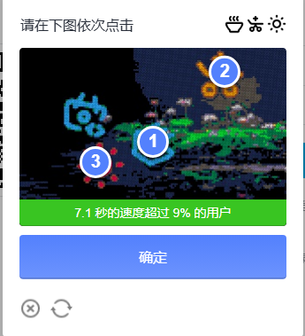

# B站文字点选验证码识别 Demo

✨ 基于 Python + DrissionPage + requests 复现的登录验证码自动化识别与鼠标模拟点击链路，
用于学习 **浏览器控制、元素级精准截图、原生 API 对接、鼠标行为模拟** 等 UI 自动化测试技术。

> ⚠️ 本项目仅作为个人自动化测试与图像识别技术学习 Demo，不包含任何批量注册或暴力破解逻辑，
> 所有账号与平台凭证均为占位符。请遵守目标网站用户协议，严禁用于商业或非法用途。
> 

## 🛠 技术栈

| 类别 | 内容 |
|---|---|
| 自动化控制 | DrissionPage |
| 网络请求 | requests |
| 图像识别 | 第三方打码平台 API（文字点选类型） |
| 数据处理 | os、time、字符串坐标解析 |

---


## 📌 功能说明


1. **页面自动化操作**：接管本地 Chrome 浏览器，精准定位登录表单并自动填充测试账号
2. **元素级截图**：仅对验证码 `geetest_widget` 区域截图，避免全屏截图导致的坐标偏移与背景干扰
3. **原生 API 封装**：**抛弃臃肿的第三方 SDK**，直接使用 `requests` 构建 multipart/form-data 请求对接打码平台
4. **行为模拟**：解析平台返回的坐标串，通过 `actions` 模块按顺序模拟鼠标移动与点击，并加入随机延时
5. **安全脱敏**：涉及账号密码与打码平台凭证的代码全部使用环境变量（`os.getenv`）读取或占位符


---


## 🧩 技术要点


- **元素级截图**：验证码识别最怕坐标错位，通过 `ele.get_screenshot()` 直接获取元素图像，确保坐标系 1:1 还原
- **SDK 轻量化**：官方 SDK 往往包含冗余代码，本项目直接调用 API，减少环境依赖且加载速度更快
- **鼠标轨迹模拟**：真实的用户点击不会瞬间完成，通过加入 `time.sleep()` 模拟人的反应间隔，降低触发风控的概率
- **异常处理**：对网络请求增加了 `try-except` 捕获，防止因打码平台网络波动导致整个自动化流程崩溃


> 注：由于合规要求，本项目不提供可直接用于高频请求的逻辑，仅演示一次正常登录的验证链路。
> 
> ---
> 

## 📂 项目结构


```text
.
├── bilibili_login_demo.py # 主流程：登录 -> 截图 -> 打码 -> 点击
├── README.md
├── .gitignore             # 忽略 __pycache__、yzm.png 等临时文件
└── run.png                # 运行效果截图
```
🚀 快速开始
1. 安装依赖
bash
pip install DrissionPage requests
2. 配置说明
运行前，请修改代码中的配置区（或通过环境变量传入），填入你自己的测试账号和打码平台凭证。代码已配置回退机制，默认读取占位符。

3. 运行
bash
python bilibili_login_demo.py
📷 运行截图



⚠️ 声明
本项目仅用于自动化测试与图像识别原理研究，代码已全面脱敏。请勿将相关技术用于恶意攻击、批量注册或非法抓取，否则后果自负。
